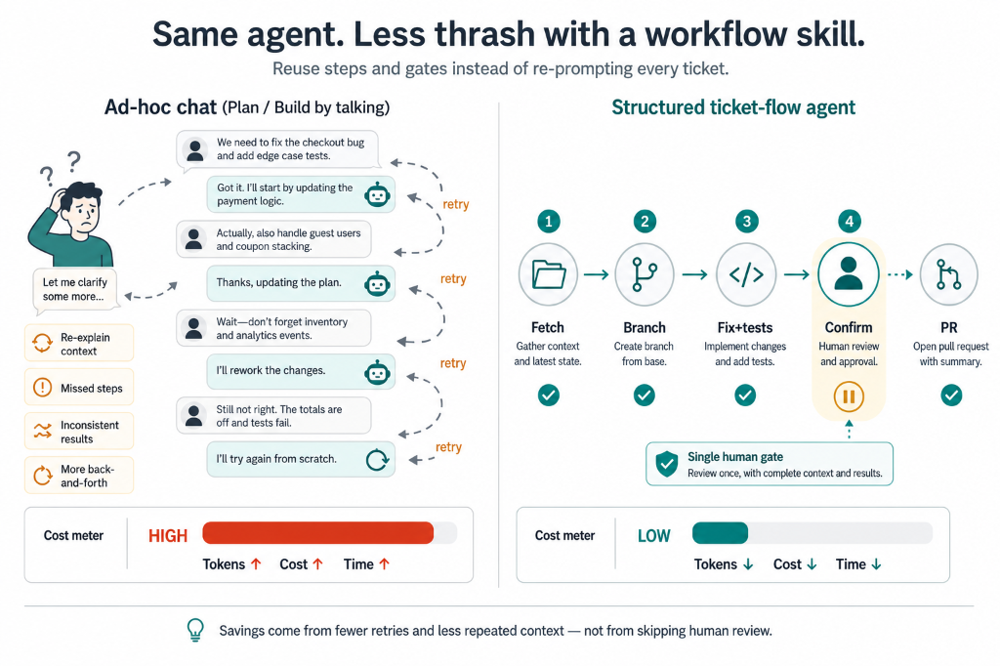
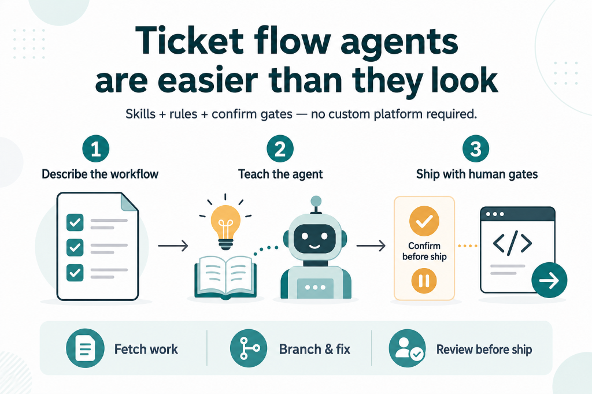

# Ticket Flow

A repeatable, high-discipline workflow for Cursor (and similar IDE agents): fetch issue → branch → implement → tests → **Confirm** → commit → **Confirm** → PR → ask before chat.

**Live site:** [https://smg99.github.io/ticket-flow/](https://smg99.github.io/ticket-flow/)  
**Companion SDLC method:** [AI-Assisted SDLC Playbook](https://smg99.github.io/engineering-ai-playbook/) — stage prompts from vague requirements through release. This repo sequences *how* an IDE agent runs once a **real ticket** exists ([Develop one story](https://smg99.github.io/engineering-ai-playbook/#stage/develop)).

## Overview

**Ticket Flow** is a thin orchestration layer, not a product.

```text
User phrase  →  rule loads skill  →  scripts + product repos  →  Confirm  →  commit/PR  →  ask before chat
```

### Why use a structured workflow?

Ad-hoc chat ("plan then build ticket X") often burns retries: wrong branch, forgotten tests, premature commit, or Slack spam. A Ticket Flow skill front-loads the path once.

#### Ad-Hoc Agent Chat vs. Ticket Flow Cost


#### Day-to-Day Agent Shape with Checklist


---

## Directory Structure

```text
ticket-flow/
├── index.html                  # Public GitHub Pages site
├── assets/                     # Site CSS, JS, OG image
├── README.md
├── LICENSE                     # MIT
├── .cursor/
│   ├── skills/ticket-flow/SKILL.md
│   └── rules/
│       ├── ticket-flow.mdc
│       └── ticket-handoff.mdc
├── docs/
│   ├── ticket-flow-agent-guide.md
│   ├── progress-template.md
│   ├── CONTRIBUTING.md
│   └── assets/
└── scripts/                    # Thin CLI wrappers (fail loud until configured)
```

## Quick Start

1. Visit the **[live guide](https://smg99.github.io/ticket-flow/)** (or open `index.html` locally).
2. Copy `.cursor/rules/*.mdc` and `.cursor/skills/` into your product repo (or multi-root this repo).
3. Configure `scripts/` for your issue tracker and chat — unconfigured scripts **error**; they do not invent data.
4. Copy `docs/progress-template.md` → `.local/progress.md` (gitignored).
5. In chat: `work on ticket PROJ-123`.

## Discoverability

- Site: [index.html](https://smg99.github.io/ticket-flow/) · [start/](https://smg99.github.io/ticket-flow/start/) · [guides/](https://smg99.github.io/ticket-flow/guides/)
- AI context: [llm.txt](https://smg99.github.io/ticket-flow/llm.txt) · [llms.txt](https://smg99.github.io/ticket-flow/llms.txt) · [llms-full.txt](https://smg99.github.io/ticket-flow/llms-full.txt)
- Crawlers: [robots.txt](https://smg99.github.io/ticket-flow/robots.txt) · [sitemap.xml](https://smg99.github.io/ticket-flow/sitemap.xml)

## Hosting

GitHub Pages publishes the repository root from `main`. `.nojekyll` disables Jekyll processing. No build step, framework, or backend.

## License

[MIT](LICENSE)
